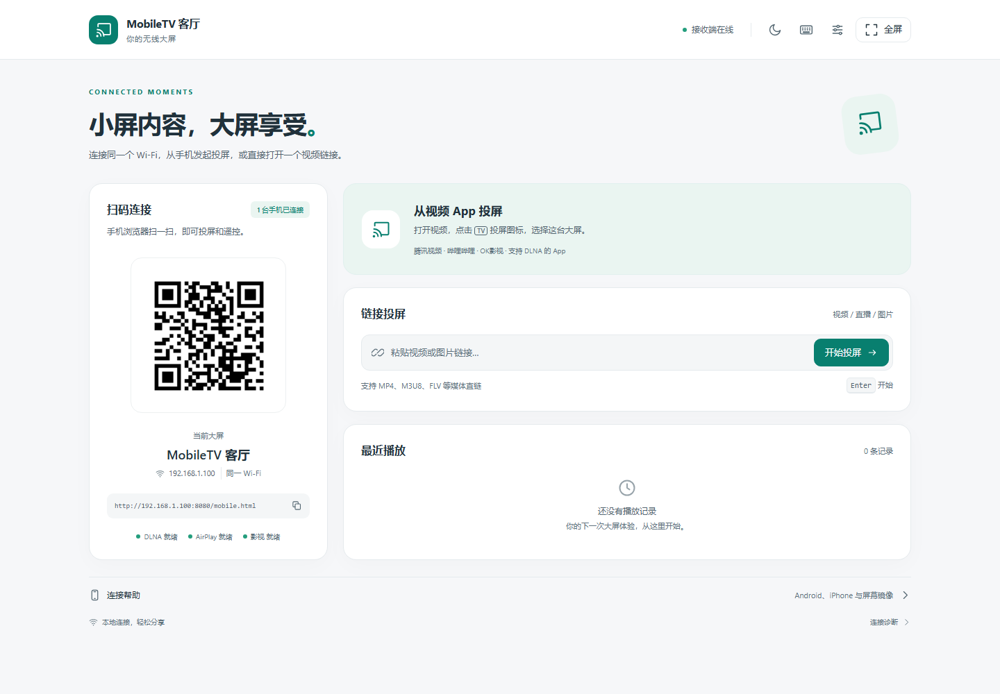
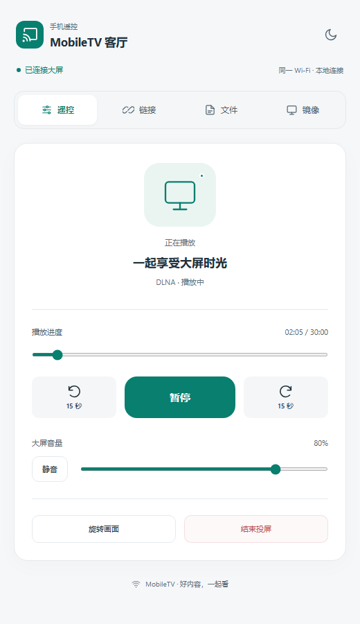

<div align="center">

# MobileTV

**在 Windows 上接收投屏，也能独立浏览影视、播放直播。**

电脑独立点播 / 直播 · DLNA / 影视投屏 · 基础 AirPlay · 网页遥控 · 键盘操作

[](https://github.com/gemron/mobile-tv-screen/releases/latest)
[](https://github.com/gemron/mobile-tv-screen/actions/workflows/ci.yml)
[](LICENSE)
[](https://github.com/gemron/mobile-tv-screen/releases/latest)

[下载安装包](https://github.com/gemron/mobile-tv-screen/releases/latest) · [使用指南](#快速开始) · [常见问题](#常见问题) · [参与开发](CONTRIBUTING.md) · [反馈问题](https://github.com/gemron/mobile-tv-screen/issues)

当前版本 [1.2.1](https://github.com/gemron/mobile-tv-screen/releases/tag/v1.2.1)（2026-11-16）：新增订阅切换、历史收藏和电视式直播，优化夸克原文件缓冲、高分辨率播放及拖动音画同步，修复换集与厂长解析。提供 Windows 安装版、便携版与 SHA-256 校验文件；[更新日志](CHANGELOG.md)及[兼容清单](docs/SOURCE_COMPATIBILITY.md)记录实测范围和未完成项。

</div>

MobileTV 在电脑上接收手机视频 App 的投屏请求，也能导入自己的订阅配置，在电脑上浏览分类、搜索影片、选集播放和观看直播，无需手机代解析。前端资源随程序分发，Windows 发行包包含 Node.js 和 FFmpeg，普通用户无需配置开发环境。

> **用途声明：本软件仅供学习、研究和非商业技术测试使用，禁止商业售卖。** 不得将本项目自有软件或修改版用于付费下载、捆绑售卖或收费授权。使用媒体与账号应遵循相应权利人的授权；第三方组件及历史 MIT 代码按各自许可执行，详见 [LICENSE](LICENSE)。

> 本项目主要提供**媒体投屏**。基础 AirPlay 不等于苹果「屏幕镜像」；Miracast 入口调用 Windows 系统设置。具体边界见[协议兼容性](#协议兼容性)。

## 界面预览

### 电脑接收端



### 手机遥控端



截图中的设备名称、地址和状态使用演示数据。

## 功能亮点

- **视频 App 投屏**：DLNA/UPnP 设备发现、播放、暂停、拖动进度和音量控制；提供影视类 App 的 HTTP 设备发现与投屏兼容接口。
- **电脑独立点播**：导入 TVBox 配置，浏览分类、搜索、分页、影片详情、切换线路、选集与自动连播；Node.js 实现通用采集接口及已适配插件，无需 Android、JVM 或模拟器。
- **我的片库**：紧凑顶部支持切换已保存的订阅；片源管理可添加、更新和命名最多 30 个地址。播放历史保留最近 200 条及剧集进度，影片和直播频道可收藏；重启后保留，续播重新解析媒体地址。
- **片单与全源搜索**：豆豆提供推荐、热播、筛选与榜单，点击片单直接找源；完整片名优先，支持拆分词和片源返回的演员资料匹配。公开网盘源参与搜索，结果逐步出现，可停止且保留键盘焦点。
- **选集与解析反馈**：详情和解析均显示加载动画，解析期间显示所选剧集、等待时间及取消按钮。快速换集忽略旧结果；关闭弹窗终止等待，超时后可重试本集或更换线路。
- **电脑独立直播**：导入 M3U、TXT、JSON 频道列表，频道编号、分组、搜索、收藏台、最近观看；播放中打开频道表，支持数字选台、上下台与多线路切换。
- **浏览器遥控**：扫描电脑界面二维码，使用手机推送媒体链接、上传视频/音频/图片、控制播放和切换显示方式。
- **实用播放器**：全屏、倍速、静音、旋转、适应/填充/拉伸、截图、浏览器支持时的画中画，以及实际解码分辨率、FPS、缓冲秒数显示。进度条用浅色标记已缓冲区间；设置面板点击外部自动收起。
- **高分辨率播放**：桌面窗口优先使用已安装的 Chrome，未安装时回退 Edge；保留原视频码流，并在重新打开窗口时恢复当前点播进度。设置中显示实际呈现帧率、最近丢帧率和缓冲秒数。
- **键盘优先**：空格播放暂停、方向键快进快退和调节音量；输入框、原生控件和弹窗保留各自的键盘行为。
- **缓冲与恢复**：HLS 点播目标前向缓冲 60 秒、最多约 90 秒，配有 64 MiB 分片缓存；夸克原文件按实际分辨率自动调整 32～256 MiB 内存缓存，以小分段并发读取并向播放器连续供流。支持重复请求合并、短时网络重试和播放进度恢复。
- **视频广告过滤**：播放器设置中可开关过滤，读取订阅广告域名和 HLS 片段规则，也可补充自己的广告域名；不重编码，保留原画质。[使用与限制](docs/AD_FILTER.md)。
- **账号与验证**：提供网盘账号、站点接口和 Cookie 设置；使用独立 Edge 配置完成站点验证，正常浏览器的登录数据不会被读取。
- **B站专用投屏（实验）**：支持画质切换、弹幕、分集连播、DASH 音视频及本机官方网页登录。Android 9.19.0 真机已识别，桌面实测 1080P/720P 切换；4K 仍取决于平台实际授权和返回。见[支持范围](docs/BILIBILI_CAST.md)。
- **夸克原文件播放**：自己的网盘文件和已授权保存的分享优先播放“原文件（原画）”，保留预览画质备用；真实 Edge 已验证 1920×1080 出画面与拖动，以及 3840×1608 MKV 兼容封装播放。原文件按需读取，不将完整影片预先下载到本地。
- **夸克保存播放（开发中）**：官方要求先保存的文件会显示文件名和空间占用，确认后只保存所选一集；复用保存任务和文件，容量不足明确提示。可用画质受账号和源文件限制。
- **登录状态检查**：区分账号资料已保存与会话验证通过，支持过期提示、阿里令牌刷新、所选网盘本机退出；[5.8.8 对照检查记录](docs/REFERENCE_5_8_8.md)。
- **本地体验**：浅色/深色主题、设备名称与网卡选择、连接诊断、内置测试视频、托盘运行、单实例启动。
- **可维护**：协议模拟测试、代理断连与缓存测试、真实 Edge 浏览器缓冲测试、Windows 成品验证脚本，以及安装版和便携版构建工具。

## 快速开始

### Windows 安装版

1. 打开 [Releases](https://github.com/gemron/mobile-tv-screen/releases/latest)，下载 `MobileTV-<版本>-Setup-x64.exe`。
2. 运行安装程序。默认安装到当前用户的 `%LOCALAPPDATA%\Programs\MobileTV`，无需管理员权限。
3. 从开始菜单启动 **MobileTV**，电脑会打开接收界面。
4. 让手机与电脑连接同一局域网；如 Windows 防火墙询问联网权限，允许在**专用网络**中通信。
5. 在视频 App **播放页**点 TV/投屏，选择电脑界面显示的设备名称。

安装程序支持简体中文和英文，可选桌面快捷方式。升级前先退出旧版托盘；卸载只移除程序，保留独立的用户数据目录。

### Windows 免安装版

下载同一 Release 中的 `MobileTV-<版本>-win-x64-<构建时间>.zip`，**完整解压**，双击 `MobileTV.exe`。

请保留 EXE 旁边的 `app`、`runtime` 和 `tools` 文件夹。便携包无需安装，但运行数据仍保存在用户目录，方便升级时保留配置。

### 手机网页投屏

用手机浏览器扫描电脑界面的二维码，打开网页遥控端：

| 入口 | 用途 |
| --- | --- |
| 遥控 | 播放、暂停、进度、音量、显示选项 |
| 链接 | 推送手机或网络上的可访问媒体 URL |
| 文件 | 上传手机本地视频、音频或图片并播放 |
| 共享 | 浏览器支持且满足安全上下文要求时，使用 WebRTC 共享屏幕或摄像头 |

媒体链接需要指向可播放的资源；普通网页地址、需要网页登录的页面和受 DRM 保护的视频不保证可用。网络媒体仍需要正常的源站连接。

### 电脑独立看影视与直播

1. 在电脑顶部选择 **影视**，粘贴自己的配置订阅 URL，点击 **保存并载入**。
2. 选择站点、分类或搜索影片，打开详情，选择线路与剧集播放。
   开发版可勾选“全部片源”跨源搜索；豆豆片单点击后直接找源。网盘线路有验证提示时，可打开官方页面登录，再重新读取。
3. 播放时可选集、上下集和开启自动连播；按 **N / P** 切换下一集 / 上一集。
4. 选择 **直播**，选择直播源、分组或搜索频道。播放中可上下台、多线路换线，**N / P** 同样适用。

配置自动保存到本机用户数据目录，升级后保留。配置仓可在导入后选择子配置；单独的 M3U / TXT / JSON 频道列表也可直接导入。

**兼容范围：**通用 XML / JSON 采集接口、CatVod HTTP API（type 4），以及 Node.js 原生站点适配器。本轮对 49 个配置条目接入了 48 个处理器，其中包含提示条目、片单、账号型网盘和仍需验证的接口；**接入数不代表 48 个源均已实际播放成功**。AI剧的原生请求签名与加密媒体链路仍待移植。各源的实际验证结果、登录要求和失效情况见[逐项兼容清单](docs/SOURCE_COMPATIBILITY.md)。

程序和发行包不捆绑 Android JAR、DEX、ARM 原生插件，也不执行订阅里的任意脚本。部分加密接口按需读取用户订阅声明的插件容器中的数据常量，校验后在内存解析，不运行 Android 字节码。源站更新、账号权限、风控和失效频道仍可能导致线路不可用。详见[源格式、适配范围与开发接口](docs/CONTENT_SOURCES.md)。

### 过滤视频广告

播放视频时打开右下角 **设置 → 过滤视频广告**。默认开启；点击 **过滤规则** 可查看订阅规则数、过滤统计和补充广告域名。如果出现误删，可立即关闭并重新加载原播放列表。纯直播、特殊分段和已经压入画面的广告暂不自动裁剪；直接连接和 FFmpeg 兼容模式的限制见[过滤说明](docs/AD_FILTER.md)。

### 关闭与后台运行

关闭浏览器接收窗口后，托盘服务会继续运行。双击托盘图标可重新打开界面；右键托盘图标，选择 **退出 MobileTV**，可结束本程序启动的 Node.js 和 FFmpeg 后台进程。

如果启动时已经存在接收服务，启动器可能复用它。更新程序后仍显示旧行为时，请同时退出旧版后台或开发版服务，再启动新版。

## 协议兼容性

| 方式 | 支持范围 | 条件与限制 |
| --- | --- | --- |
| DLNA / UPnP | SSDP 发现、设备描述、AVTransport / RenderingControl 播放控制 | 发送端实现和媒体编码会影响兼容性 |
| 影视 / TVBox HTTP | HTTP 设备发现、扫码辅助发现、接收手机已解析媒体地址与播放控制 | 依赖发送端兼容相应接口；本机设备名可能附带「影视」后缀 |
| AirPlay | 传统 HTTP 视频、HLS、照片与基本进度控制 | **不支持**苹果屏幕镜像、RAOP 音频、FairPlay / DRM；目前主要通过协议模拟测试，尚未完成苹果真机兼容性验证 |
| WebCast | 网页媒体链接、文件上传、网页遥控 | 需要浏览器支持媒体编码，或使用 FFmpeg 转封装 |
| WebRTC | 屏幕/相机采集和局域网信令转发 | 属于实验功能；普通手机 HTTP 局域网页面通常不满足采集所需的 HTTPS 安全上下文，移动浏览器也可能不支持屏幕采集 |
| Miracast | 一键打开 Windows「投影到此电脑」设置 | 实际接收由 Windows 无线显示功能、网卡和系统组件提供，MobileTV 本身不实现 Miracast 协议栈 |

项目与腾讯视频、OK影视、Apple、Microsoft 等服务或品牌无隶属关系；App 名称仅用于兼容性说明。

## 画质、传输模式与缓冲

### 传输模式

| 模式 | 行为 | 建议 |
| --- | --- | --- |
| 智能代理（推荐） | 跨来源媒体通过电脑代理，HLS 子清单和分片地址同步重写 | 日常使用的默认模式，适合手机媒体服务未提供 CORS 的情况 |
| 极速直连 | 浏览器直接读取原始媒体地址 | 源站允许浏览器访问且兼容性良好时使用 |
| 强制防盗链代理 | 强制经过本机代理，按常见源站附带请求头 | 对部分来源有帮助，不保证绕过鉴权或所有防盗链机制 |
| FFmpeg 转封装 | 将输入整理为浏览器可播放的 fragmented MP4；默认复制视频码流，音频可转换为 AAC | 用于部分容器兼容问题；不是任意编码的万能解码方案 |

代理和视频码流复制不会提高源视频清晰度，也不会把低分辨率视频变成真实高清。播放器展示的分辨率来自视频解码结果。默认界面不会请求有损的视频重编码；源站提供多档 HLS 时，播放器仍可能根据网络条件选择档位。

MKV 自动采用 FFmpeg 兼容封装，直接复制视频码流，音频转换为 AAC，并保留影片总时长和续播位置。HEVC 视频仍需浏览器和显卡支持对应解码；缺少支持时会明确提示。真实 Edge 已验证 3840×1608 MKV 出画面并连续播放，其他设备的流畅度取决于网络和解码能力。

兼容封装保留 MP4 的音视频时间轴编辑信息，避免拖动后因视频关键帧预解码与音频裁剪起点不同而出现声音提前。合流 HEVC/EAC3 和音视频分离的 DASH 均有真实闪光／提示音对照测试。

本机对同一段 3840×1608、24 FPS HEVC 做本地文件对照：Edge 的平台解码路径在 15 秒内丢约 79 帧，Chrome 的 D3D11 硬件解码路径为 0 丢帧，两者均无缓冲中断。因此桌面播放器优先使用已安装的 Chrome；不下载浏览器，也不转换视频编码。该结果只代表这台电脑和样本，其他显卡、驱动及片源需分别验证。需要优先使用 Edge 时，可设置环境变量 `MOBILETV_PLAYER_BROWSER=edge` 后重新启动程序。

### 缓存策略

- HLS 点播前向缓冲目标为 **60 秒**，低码率时最多约 **90 秒**，保留约 **30 秒**已播放数据便于回退。
- 直播使用较短的前向缓冲窗口，避免照搬点播缓存造成明显直播延迟。
- 接收端完整 HLS 分片缓存上限为 **64 MiB**，单分片最多 **16 MiB**，同时最多 4 个缓存填充任务；默认有效期最多 120 秒，并按源站缓存策略缩短或禁用复用。
- 同一分片的并发请求可共用一次下载；不完整或超限的数据不会进入缓存。直播资源、加密密钥、字节范围资源及要求不缓存的响应不会作为普通点播分片复用。
- 内存缓存与播放器缓冲是两层机制。64 MiB 不是整个程序的内存占用上限，浏览器、解码器和运行时还会使用内存。
- 普通 MP4 等媒体保持流式转发和 Range 拖动支持，不会为了缓存先下载整部影片。
- 夸克原文件按 **96 KiB** 分块，最多 **96 路**并行，初始前向预读约 **22.5 MiB**，缓存上限 **32 MiB**；取得实际解码分辨率后按下表自动扩展，并结合文件大小和时长估算码率。官方原文件地址优先使用 HTTP/2 多路复用；连接约 900 次请求后提前轮换，已有读取正常结束，不支持时回退 HTTP/1。对播放器保留连续的 HTTP Range 响应，将多个上游小分段按顺序拼接，未完成的分块也可即时供播放。原生播放的起播缓冲目标约 10 秒；兼容封装使用约 2 秒的短缓冲，以适应浏览器暂停时只预载少量 MP4 数据的限制。读取到元数据后最多额外等待 12 秒，已有解码画面但没有缓冲区间时直接起播。拖动优先并取消过时读取，已收齐、正在结束的分块保留入缓存；停止或换片清空原文件缓冲。缓存按临时地址和凭据上下文隔离，不写入磁盘，不改变视频清晰度。

| 实际分辨率档位 | 缓存容量上限 | 前向预读目标 | 前向预读字节范围 |
| --- | --- | --- | --- |
| 720p | 64 MiB | 约 90 秒 | 16～48 MiB |
| 1080p | 128 MiB | 约 120 秒 | 32～96 MiB |
| 2K | 192 MiB | 约 150 秒 | 48～144 MiB |
| 4K 及以上 | 256 MiB | 约 180 秒 | 64～192 MiB |

时间目标按影片平均码率估算，并为码率波动留出余量，受字节上限约束；高码率视频不一定能覆盖表中的全部秒数。缓存按需填充，不预先分配最大容量；切换清晰度重置策略，旧会话的分辨率不会覆盖新会话。播放器设置中显示原文件缓存档位、当前用量和容量上限。这层服务端预读独立于浏览器显示的可播放缓冲秒数。

同一下载地址的独立取流对照中，原 HTTP/1 链路约 4.5 Mb/s，HTTP/2 配合 96 路并发在两个连续 6 秒窗口达到约 30～34 Mb/s。实际速度随源站和网络变化；当前档位的预读窗口填足后会减少请求，带宽回落属于正常行为。网络统计同时计入尚未下载完整的分块，避免将部分供流误计为零。

测试曾在合成 HLS 视频提前缓冲约 56 秒后，模拟源站连续不可用 8 秒，观察到播放继续推进且没有新增 `waiting` 事件。这个结果验证短时断流缓冲行为，**不能保证所有网络、片源和设备都不会卡顿**；持续低于视频码率的带宽仍会耗尽缓冲。

## 键盘快捷键

| 按键 | 操作 |
| --- | --- |
| `Space` / `K` | 播放 / 暂停 |
| `←` / `→` | 快退 / 快进 10 秒 |
| `↑` / `↓` | 音量调整 5% |
| `M` | 静音 / 恢复声音 |
| `F` | 进入 / 退出全屏 |
| `?` | 打开快捷键帮助 |
| `Esc` | 关闭当前面板或按浏览器行为退出全屏 |

快捷键在文本输入框和选择框中不会接管输入；浏览器自身快捷键仍然有效。

## 配置、端口与数据

### 默认端口

| 端口 | 用途 |
| --- | --- |
| TCP `8080` | 电脑界面、手机遥控、HTTP API、WebSocket、媒体代理 |
| TCP `7000` | 基础 AirPlay HTTP 接收；绑定失败时会记录诊断信息 |
| TCP `9978` | 影视 / TVBox HTTP 设备发现与投屏 |
| UDP `1900` | DLNA / SSDP 局域网设备发现 |
| UDP `5353` | AirPlay mDNS / Bonjour 发现，由相关库使用 |

这些服务面向可信局域网。当前没有用户登录、设备配对或公网访问鉴权；请勿将端口直接映射到公网，详见 [SECURITY.md](SECURITY.md)。

### 用户数据

Windows 发行版默认使用 `%LOCALAPPDATA%\MobileTV\data`：

| 内容 | 保存方式 |
| --- | --- |
| `device-config.json` | 设备名称、UUID、MAC 标识；首次运行生成 |
| `uploads/` | 上传文件；每次上传完成后清理到最近 12 个文件，单文件上限 2 GiB |
| `sample-test.mp4` | 按需生成的本地诊断视频 |
| `logs/` | Windows 启动器的运行日志 |
| `browser/` | 桌面接收窗口使用的独立浏览器配置 |
| `browser-chrome/` | Chrome 桌面播放窗口的独立配置，与 Edge 配置分开保存 |
| 播放历史、状态和分片缓存 | 进程内存中保存，接收服务重启后清空 |

源码启动默认使用项目根目录下的 `data/`。可以通过 `MOBILETV_DATA_DIR` 指定独立目录。公开仓库和发行包不包含开发电脑的设备配置、上传文件和日志。

### 环境变量和启动参数

| 配置 | 默认值 | 说明 |
| --- | --- | --- |
| `PORT` | `8080` | 源码服务的主 HTTP 端口 |
| `AIRPLAY_PORT` | `7000` | 基础 AirPlay 端口 |
| `TVBOX_PORT` | `9978` | 影视兼容端口 |
| `MOBILETV_DATA_DIR` | 见上文 | 配置、上传与日志数据目录 |
| `NO_OPEN=1` | 未设置 | 源码运行时不自动打开浏览器 |
| `MOBILETV_PLAYER_BROWSER` | Chrome 优先 | Windows 桌面窗口设为 `edge` 时优先使用 Edge，未找到时仍回退可用浏览器 |
| `DISABLE_DLNA=1` | 未设置 | 禁用 DLNA 发现与接收服务 |
| `DISABLE_AIRPLAY=1` | 未设置 | 禁用基础 AirPlay 服务 |
| `DISABLE_TVBOX=1` | 未设置 | 禁用影视兼容服务 |
| `CAST_DIAGNOSTICS=1` | 未设置 | 输出影视请求诊断信息，排障后建议关闭 |

Windows 启动器参数：

```powershell
.\MobileTV.exe --port 8080
.\MobileTV.exe --no-window
.\MobileTV.exe --quit --port 8080
```

启动器通过 `--port` 选择主端口，未指定时使用 8080；修改 `PORT` 环境变量主要适用于直接运行 Node.js 源码。影视 App 的默认端口探测逻辑可能固定，修改 9978 前请确认发送端支持。

## 从源码运行

推荐使用 **Node.js 24 LTS** 和可通过 `PATH` 调用的 FFmpeg。Windows 桌面发行版针对 Windows 10 2004 及以上、Windows 11 x64 构建；其他系统可以自行尝试 Node.js 服务，但没有对应的桌面安装包与同等验证范围。

```powershell
git clone https://github.com/gemron/mobile-tv-screen.git
cd mobile-tv-screen
npm ci
npm start
```

打开 `http://127.0.0.1:8080/`。开发时可以使用 `npm run dev`。如果无需 AirPlay 或影视接收，可设置对应禁用变量后启动。

```powershell
$env:NO_OPEN = '1'
$env:MOBILETV_DATA_DIR = 'D:\MobileTV-data'
npm start
```

## 构建与验证

### Windows 发行构建

本仓库提供固定版本构建工具准备脚本，下载后验证 SHA-256。Inno Setup 以便携模式放在 `build/tools/` 中，不会添加系统安装项。

```powershell
npm ci
powershell -NoProfile -ExecutionPolicy Bypass -File scripts/prepare-build-tools.ps1
npm test
npm run build:win
npm run build:installer
npm run test:release -- --zip
npm run test:installer
```

- `build:win`：使用当前 x64 Node.js、生产依赖和 FFmpeg 生成便携目录、ZIP、SHA-256 文件与 `dist/latest-release.json`。
- `build:installer`：从最新便携目录编译当前用户安装版 EXE，同时生成发布附件校验清单。
- `test:release`：使用已编译 EXE 验证启动、独立数据目录、离线资源、分片缓存、Range、FFmpeg、控制和退出；`--zip` 会先验证校验和并解压到含中文和空格的临时路径。
- `test:installer`：在临时目录静默安装、运行成品验证并卸载，不使用正常的用户数据目录。

如已自行安装工具，可以通过 `FFMPEG_PATH` 指定 `ffmpeg.exe`，通过 `ISCC_PATH` 指定 Inno Setup 7 的 `ISCC.exe`。FFmpeg 所在发行目录应包含相应 `LICENSE` 与 `README.txt`。

### 测试命令

```powershell
npm test
npm run test:buffering
npm run test:library:browser
```

`npm test` 包含播放器路由/快捷键/故障恢复、代理断连、缓存边界、HTTP/2 复用与连接轮换、独立点播与直播、HTML 适配器、影视投屏兼容、DLNA/SSDP、AirPlay 模拟和媒体 Range 测试。`test:buffering` 与 `test:library:browser` 需要 Windows、Edge 和 FFmpeg，会创建独立无头浏览器；后者验证配置导入、分类详情、带请求头的真实 HLS 播放、自动连播与换台，默认只访问本地测试源。

本地 4K 性能验收使用自己的短视频样本，并开启浏览器 GPU：

```powershell
npm run test:4k -- --file "D:\videos\sample-4k.mp4" --browser chrome
```

测试创建独立临时配置，不读取账号；连续测量 20 秒的实际分辨率、播放推进、缓冲中断和丢帧，丢帧超过 5% 则失败。可将 `--browser chrome` 改为 `--browser edge` 对照当前电脑的不同播放路径。

`npm test` 同时校验转封装音画同步：生成带 B 帧、长关键帧间隔的 HEVC/EAC3 样本，通过不规则闪光和提示音比较起播及非关键帧拖动后的真实时间差，也覆盖分离音视频。开发环境需提供 FFmpeg 和 FFprobe。`npm run test:sync -- --browser chrome` 还会创建独立 GPU 浏览器，通过 Canvas 与 Web Audio 检查实际呈现的同步。

协议模拟成功不代表已经覆盖所有品牌手机和商业视频 App。新客户端兼容问题欢迎附上经过脱敏的诊断信息反馈。

## 项目结构

```text
public/                 电脑接收界面、手机遥控页和播放器
src/
  server.js             HTTP / WebSocket 服务入口
  content/              Node.js 点播、直播、配置解码与站点适配
  protocols/            DLNA、基础 AirPlay、影视 HTTP 协议
  services/             播放状态、媒体代理、分片缓存
  utils/                网卡选择、设备标识、数据目录
  diagnostics/          可选诊断探针
packaging/              C# 托盘启动器、Windows 清单、Inno Setup 脚本
scripts/                构建工具准备、打包、成品与安装验证
tests/                  自动化测试与真实浏览器验证
docs/images/            README 演示截图
.github/workflows/      持续集成与发行构建
```

## 常见问题

<details>
<summary><strong>视频 App 搜不到设备，应该先检查什么？</strong></summary>

1. 手机与电脑连接同一路由器下可互访的网络，避免访客 Wi-Fi、AP 隔离或跨 VLAN。
2. 在电脑界面确认 DLNA / AirPlay / 影视状态，选择正确的实体网卡。
3. 从手机自带浏览器打开电脑显示的网页遥控地址。不同 App 的访问权限可能不同，浏览器成功并不代表所有 App 都已获得局域网权限。
4. 检查 Windows 专用网络防火墙放行情况，以及手机 App 的附近设备/本地网络授权。
5. 尝试视频**播放页**的 TV 按钮。首页设备同步入口可能搜索另一类设备。
6. Android 17 上使用支持相应本地网络权限的新版本 App；旧版 App 即使能够扫码，也可能无法发现设备。

</details>

<details>
<summary><strong>能搜索到设备，但点了以后没有画面？</strong></summary>

先查看电脑的连接诊断。如果已收到媒体地址，使用默认智能代理模式；需要登录、带短期签名、编码不兼容或 DRM 保护的片源可能无法直接播放。用设置中的本地测试视频区分接收端问题与源站问题，再尝试其他公开、可播放的媒体链接。

</details>

<details>
<summary><strong>Chrome 打不开局域网页面，但手机自带浏览器可以？</strong></summary>

检查 Chrome 的网站权限、局域网访问限制以及按 App 生效的联网设置。确认输入的是完整 `http://电脑IP:8080/`；不要将手机上的 `127.0.0.1` 当作电脑地址。也可以用自带浏览器完成网页遥控，然后分别排查视频 App 的网络权限。

</details>

<details>
<summary><strong>苹果控制中心「屏幕镜像」能用吗？</strong></summary>

当前不支持。项目实现的是传统 AirPlay 视频/照片 HTTP 接收，尚未实现苹果屏幕镜像、RAOP 或 FairPlay。文档中的 AirPlay 协议测试不代表镜像功能或苹果真机已经验证。

</details>

<details>
<summary><strong>为什么视频仍然会缓冲？缓存不是已经加大了吗？</strong></summary>

缓存需要提前下载数据。源站持续低速、手机代理服务停止、Wi-Fi 丢包、设备解码能力不足和视频码率过高仍然会影响播放。可观察播放器中的缓冲秒数、FPS 和丢帧信息；电脑使用网线或较稳定的 Wi-Fi，并选择稳定片源，通常比反复切换模式更有效。

</details>

<details>
<summary><strong>怎么升级、校验或卸载？</strong></summary>

先从托盘完全退出旧版。安装版运行新的 Setup EXE；便携版解压到新目录。用户配置与上传目录独立保存，卸载后如需清除，可在确认不再需要文件后自行删除数据目录。

Release 中提供 `SHA256SUMS.txt`，可核对下载附件：

```powershell
Get-FileHash .\MobileTV-1.1.0-Setup-x64.exe -Algorithm SHA256
```

安装程序暂未配置商业代码签名。请从本仓库正式 Release 获取文件并核对校验和。

</details>

## 贡献与许可证

欢迎通过 [Issue](https://github.com/gemron/mobile-tv-screen/issues) 报告兼容问题，或提交聚焦的 Pull Request。提交前请阅读 [贡献指南](CONTRIBUTING.md)。安全问题请遵循 [安全说明](SECURITY.md)，不要公开包含访问凭据的媒体 URL 或日志。

从 1.2.1 起，项目有权授权的自有代码采用[学习研究与非商业使用许可证](LICENSE)，源码公开，禁止商业售卖。由于限制商业用途，不将其称为 OSI 开源许可；参见 [OSI 开源定义](https://opensource.org/osd)。此前已按 [MIT](https://opensource.org/license/mit) 发布的版本与代码继续保留原授权，不能通过本次声明撤回；[历史 MIT 文本](docs/licenses/MIT-legacy.txt)。

发行包中的 Node.js、FFmpeg 和 npm 依赖遵循各自许可证，项目的非商业限制不适用于这些独立组件。FFmpeg 是单独运行的外部程序。详见 [第三方组件说明](THIRD_PARTY_NOTICES.md) 和发行包内的 `licenses/`、`THIRD-PARTY-NOTICES.txt`。

感谢 [Node.js](https://nodejs.org/)、[FFmpeg](https://ffmpeg.org/)、[hls.js](https://github.com/video-dev/hls.js)、[mpegts.js](https://github.com/xqq/mpegts.js)、[Express](https://expressjs.com/) 及其他开源依赖。
