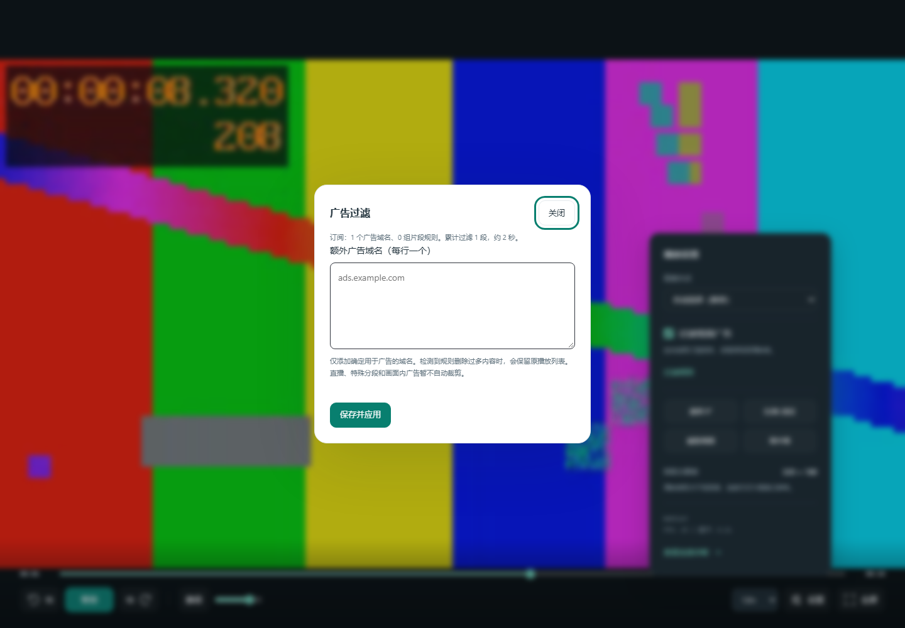

# 视频广告过滤

在播放器右下角打开 **设置 → 过滤视频广告**。默认开启，切换后会重新加载当前视频并尝试恢复进度。**过滤规则** 中可以查看订阅规则数量、累计跳过的片段与时长，并补充额外广告域名，每行一个。设置保存在用户数据目录的 `ad-filter.json`。



## 支持的规则

- 订阅 `ads` 中的广告域名：按域名标签匹配，包含其子域名；不会把 `notads.example.com` 当成 `ads.example.com`。
- 订阅 `rules` 中按播放列表主机限定、明确包含 `#EXTINF` 的片段正则。普通嗅探、播放地址识别规则和脚本不作为删除指令运行。
- 成对的 `#EXT-X-CUE-OUT` / `#EXT-X-CUE-IN` 广告区间标记。
- 用户自行添加的广告域名。

例如自己的配置可以包含：

```json
{
  "ads": ["ads.example.com"],
  "rules": [{
    "name": "示例片段规则",
    "hosts": ["video.example.com"],
    "regex": ["#EXTINF:2,[\\s\\S]*?advertisement\\.ts\\n"]
  }]
}
```

规则由订阅提供，是否准确取决于源站。推荐先使用源自带的规则，再补充确认用于广告的域名。普通短片段、CDN 切换和 `#EXT-X-DISCONTINUITY` 本身都不会触发删除。

## 播放与保护

过滤只改写 HLS 点播列表，不修改或重编码保留下来的音视频分片。删除后重新接续时间线，并为隐含序号 IV 的 AES-128 加密片段补回原始 IV，避免后续正片解密错误；密钥、初始化片段和媒体请求仍沿用原代理请求头。

为减少误删，遇到以下情况会保留原列表：直播滚动窗口、低延迟分片、字节范围清单、I-frame 清单、不完整或不认识的结构、删除全部视频、一次删除超过 180 秒或总时长的 40%。这些限制当前不可在界面放宽。

订阅正则放在隔离线程执行，最长 250 毫秒，最多同时处理两份列表。规则超时、错误或服务繁忙时保留原列表，不阻塞投屏控制。单份播放列表仍受 4 MiB 上限约束。

关闭开关后不会应用删除规则。过滤统计是服务启动以来的累计值，不代表当前影片的唯一广告时长。

## 适用边界

- 使用自动连接或电脑代理播放 HLS 时生效。直接连接不会经过服务端；从过滤开关切换时会改用代理。
- FFmpeg 兼容模式直接读取上游媒体，当前不应用此过滤。可切回自动连接使用。
- MP4 内嵌广告、画面水印、口播、弹幕和 DRM 媒体无法通过清单过滤消除。
- 本功能参考同类影视播放器的订阅规则使用方式，使用独立 Node.js 实现；不包含 OK影视或影视TV 的播放器代码，也不宣称过滤效果完全相同。

## 验证

```powershell
node tests/ad-filter.js
npm run test:adfilter:browser
```

本地测试覆盖域名边界、规则主机范围、广告标记、误删回退、恶意正则超时、代理和设置保存。真实 Edge 使用本地生成的 AES-128 视频，移除一个广告片段后继续播放，验证后续片段的隐含 IV、视频时长和规则设置界面。
